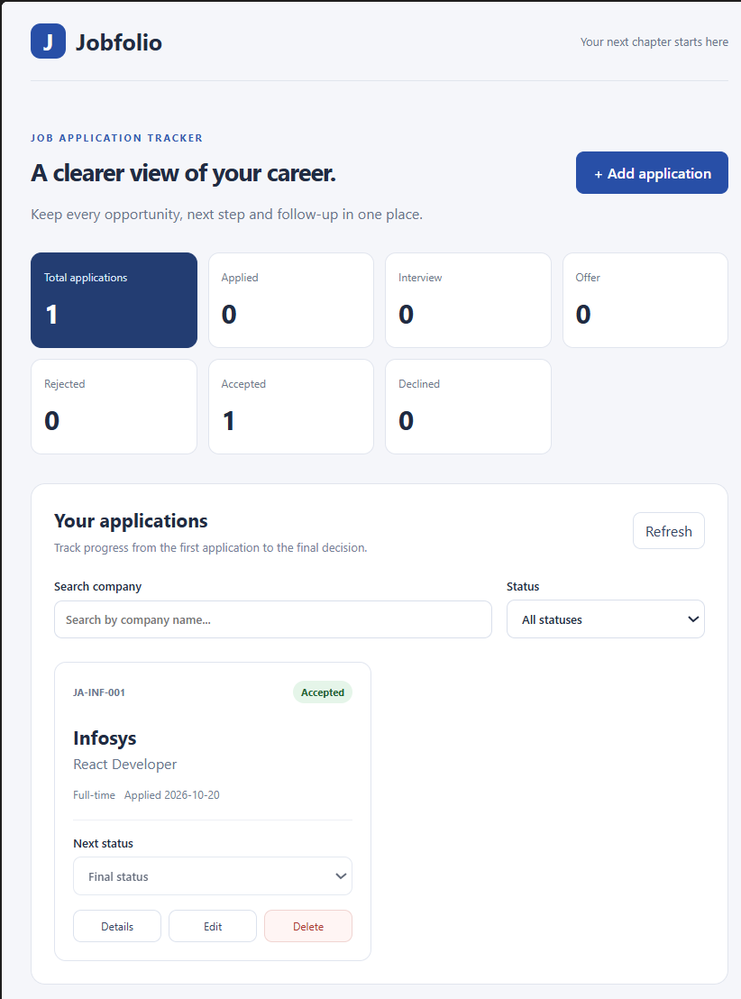
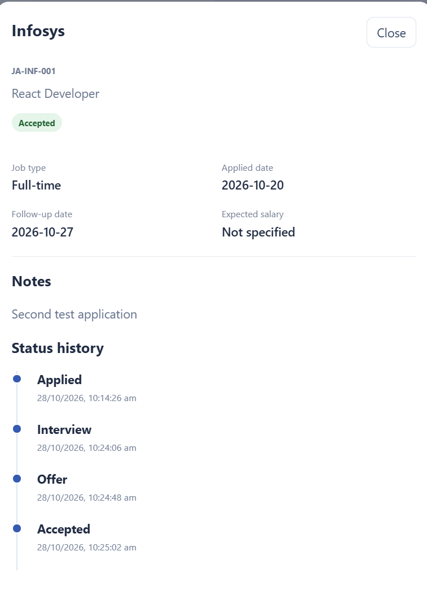

# Job Application Tracker — Jobfolio

A responsive MERN application for recording job applications and tracking their progress.

**Developed by:** Joshua Mathew Varghese  
**College:** Sahrdaya College of Engineering and Technology  
**Project type:** Individual project

## Technology Stack

- Frontend: React, Vite, CSS
- Backend: Node.js, Express.js
- Database: MongoDB Atlas with Mongoose

## Features

- Create, view, edit and delete job applications.
- Backend-generated application IDs with a sequence per company.
- Applied Date validation on both frontend and backend.
- Controlled status transitions with a timestamped history.
- Automatic follow-up date, seven days after the Applied Date.
- Red overdue badge for Applied applications past their follow-up date.
- Case-insensitive duplicate prevention for active applications.
- Backend company search and status filtering.
- Application counts for each status.
- Responsive interface with deletion confirmation.

## Project Structure

```text
Job_Application_Tracker/
├── frontend/
├── backend/
│   ├── models/
│   ├── routes/
│   ├── .env
│   └── server.js
├── screenshots/
│   ├── dashboard.png
│   └── status-history.png
└── README.md
```

## Run Locally

Install Node.js and use two separate terminals.

### Backend

```bash
cd backend
npm install
node server.js
```

The backend runs at http://localhost:5000.

### Frontend

```bash
cd frontend
npm install
npm run dev
```

Open the local URL printed by Vite, usually http://localhost:5173.

The frontend calls http://localhost:5000/api/applications.

## Environment Variables

The backend/.env file is included for exam evaluation and contains
dedicated test database credentials.

```env
PORT=5000
MONGODB_URI=<included exam MongoDB Atlas connection string>
```

The database user is restricted to the jobTrackerExam database.
An evaluator's IP address must be permitted in MongoDB Atlas Network Access.

## REST APIs

All responses use the format:

```json
{
  "success": true,
  "message": "Operation description",
  "data": {}
}
```

Error responses use success: false and data: null.

| Method | Endpoint | Purpose |
| --- | --- | --- |
| GET | /api/health | Check backend and database connectivity |
| GET | /api/applications | List applications and return status counts |
| GET | /api/applications?search=Infosys&status=Applied | Search by company and filter by status |
| GET | /api/applications/:id | Get application details and status history |
| POST | /api/applications | Create an application |
| PUT | /api/applications/:id | Edit company, role, job type, salary and notes |
| PATCH | /api/applications/:id/status | Change status using the allowed workflow |
| DELETE | /api/applications/:id | Delete an application when permitted |

The :id parameter is the MongoDB document ID returned in _id.

### Example Create Request

```json
{
  "company": "Infosys",
  "role": "React Developer",
  "jobType": "Full-time",
  "appliedDate": "2026-10-20",
  "salary": 400000,
  "notes": "Applied through the company website."
}
```

### Example Status Request

```json
{
  "status": "Interview"
}
```

## Business Rules

- New applications start as Applied.
- Applied → Interview or Rejected.
- Interview → Offer or Rejected.
- Offer → Accepted or Declined.
- Rejected, Accepted and Declined are final statuses.
- Application ID and Applied Date cannot be edited.
- Interview and Offer applications cannot be deleted.
- Duplicate company and role combinations are blocked while active.
- Follow-up dates and overdue flags are calculated by the backend.
- Application IDs follow the pattern JA-INF-001.

## HTTP Status Codes

- 200: Successful read, update or deletion.
- 201: Application created.
- 400: Invalid input or disallowed operation.
- 404: Application not found.
- 409: Duplicate conflict.
- 500: Unexpected server error.
- 503: Database unavailable during health check.

## Screenshots

### Dashboard



### Status History

